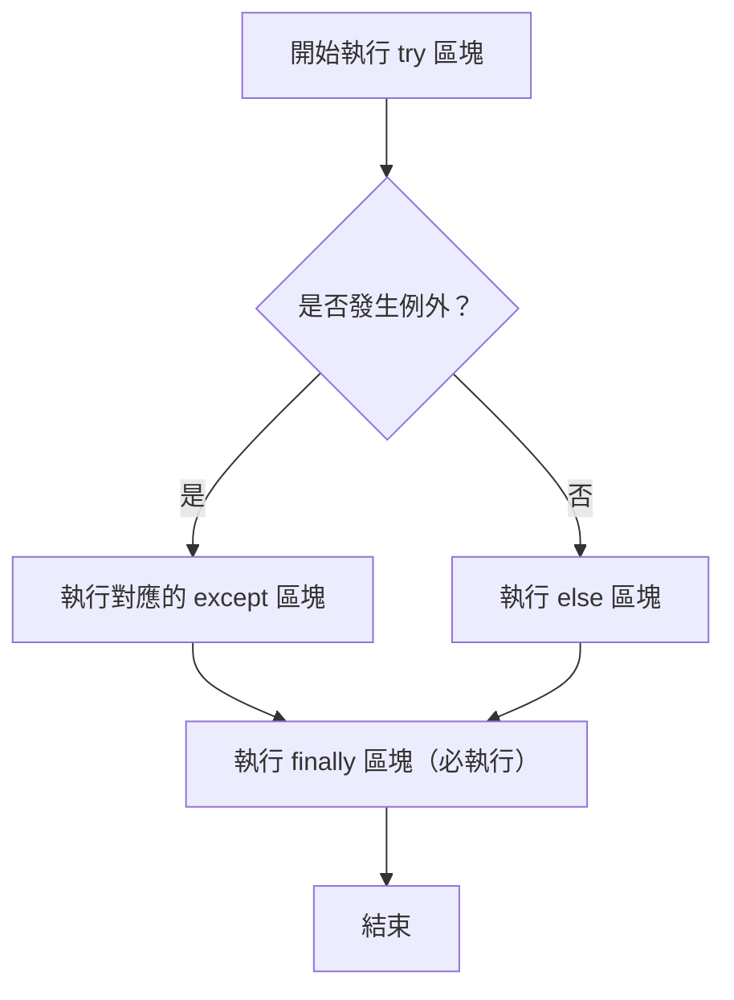

# Python `try ~ except` 例外處理教學講義（由淺至深）

這份講義專為課堂循序講解設計，從「為什麼程式會當掉」出發，一步步帶你掌握 `try`、`except`、`else`、`finally`、`raise`，最後銜接單元測試實務。

---
+++
## 目錄
1. [Level 1：為什麼程式會當掉？（錯誤 vs. 例外）](#level-1為什麼程式會當掉錯誤-vs-例外)
2. [Level 2：第一道防線 — 基本 `try ... except`](#level-2第一道防線--基本-try--except)
3. [Level 3：精準攔截 — 指定例外型別與 `as e`](#level-3精準攔截--指定例外型別與-as-e)
4. [Level 4：完整流程控制 — `else` 與 `finally`](#level-4完整流程控制--else-與-finally)
5. [Level 5：主動防禦 — `raise` 與單元測試實務](#level-5主動防禦--raise-與單元測試實務)
6. [Level 6：常見地雷與課堂練習](#level-6常見地雷與課堂練習)

----

## Level 1：為什麼程式會當掉？（錯誤 vs. 例外）

寫 Python 時，常見的「出錯」分成兩種：

| 類型 | 英文名稱 | 何時發生 | 程式能不能啟動？ | 常見例子 |
| :--- | :--- | :--- | :--- | :--- |
| **語法錯誤** | `SyntaxError` | 執行前（解析程式碼時） | 無法啟動 | 少寫冒號 `:`、括號沒成對 |
| **執行期例外** | `Exception` | 程式執行到那一行時 | 可以啟動，但遇到狀況就中斷 | `10 / 0`、`int("abc")`、找不到檔案 |

### 沒有例外處理會發生什麼事？

```python
print("1. 程式開始")
num = int("abc")  # ValueError: invalid literal for int() with base 10: 'abc'
print("2. 程式結束")  # 這行永遠不會被執行
```

只要某一行發生未處理的例外，Python 就會立刻停止程式並印出紅色的錯誤追蹤（Traceback）。

---

## Level 2：第一道防線 — 基本 `try ... except`

如果把可能出錯的程式碼放進 `try:`，把「出錯時的備案」放進 `except:`，程式就不會直接當掉。

```python
print("1. 程式開始")

try:
    num = int("abc")
    print(f"轉換成功：{num}")
except:
    print("轉換失敗：請輸入有效的數字！")

print("2. 程式繼續正常結束")
```

**執行流程：**
1. 進入 `try` 區塊執行 `int("abc")`。
2. 發生錯誤後，**跳過 `try` 剩下的程式**，直接進入 `except`。
3. 執行完 `except` 後，程式繼續往下跑，不會崩潰。

> [!TIP]
> **生活比喻**：`try` 就像是「試著走這條路」，`except` 則是「如果路不通，就改走備用道路」，目的地（程式後續流程）依然能順利抵達。

---

## Level 3：精準攔截 — 指定例外型別與 `as e`

### 3.1 為什麼不要只寫 `except:`？
只寫 `except:` 會把「所有」錯誤都當成同一件事處理，容易掩蓋真正的 Bug。實務上應該**指定要攔截的例外型別**。

```python
try:
    x = int(input("請輸入除數："))
    result = 100 / x
    print(f"結果：{result}")
except ValueError:
    print("輸入的不是整數！")
except ZeroDivisionError:
    print("除數不能是 0！")
```

### 3.2 合併多個例外並取得錯誤訊息（`as e`）

當兩種錯誤想用同一種方式處理，或想印出 Python 原本的錯誤說明時，可以這樣寫：

```python
try:
    x = int("hello")
    result = 100 / x
except (ValueError, ZeroDivisionError) as e:
    print(f"計算失敗，原因：{e}")
```

**常見內建例外型別速查：**
- `ValueError`：型別對但值不合理（例如 `int("abc")`）
- `ZeroDivisionError`：除以零（例如 `10 / 0`）
- `TypeError`：型別不相容（例如 `"10" + 5`）
- `IndexError`：串列索引超出範圍（例如 `[1, 2][5]`）
- `KeyError`：字典找不到對應的鍵（例如 `{"a": 1}["b"]`）
- `FileNotFoundError`：找不到指定的檔案

---

## Level 4：完整流程控制 — `else` 與 `finally`

除了 `try` 和 `except`，Python 還提供 `else` 與 `finally` 讓流程更嚴謹：

- **`else`**：只有當 `try` **完全沒有發生例外**時才會執行（適合放成功後的後續邏輯，避免把太多程式碼塞進 `try`）。
- **`finally`**：**無論有沒有發生例外**，最後都一定會執行（適合放關閉檔案、釋放資源、印出結束紀錄等善後工作）。



### 完整四部曲範例

```python
def safe_divide(a, b):
    try:
        result = a / b
    except ZeroDivisionError:
        print("錯誤：不能除以 0")
    else:
        print(f"計算成功：{a} / {b} = {result}")
    finally:
        print("本次計算流程結束\n")

safe_divide(10, 2)
safe_divide(10, 0)
```

---

## Level 5：主動防禦 — `raise` 與單元測試實務

有時候程式不會自動報錯，但**業務邏輯上不允許**（例如負數的年齡、除數為零時要統一回傳特定訊息），這時可以用 `raise` 主動拋出例外。

### 5.1 使用 `raise` 主動拋出例外
參考本目錄的 [calc.py](file:///C:/Users/User/Documents/git%20檔案/2026_11_25/calc.py)：

```python
def divide(a, b):
    """Return a divided by b, raising ValueError when b is zero."""
    if b == 0:
        raise ValueError("除數不可為零")
    return a / b
```

呼叫端就可以用 `try ... except ValueError as e:` 接住並顯示明確的中文訊息：

```python
from calc import divide

try:
    print(divide(10, 0))
except ValueError as e:
    print(f"捕捉到預期錯誤：{e}")
```

### 5.2 如何測試「預期會拋出例外」的函式？
在自動化測試中（參考 [test_calc.py](file:///C:/Users/User/Documents/git%20檔案/2026_11_25/tests/test_calc.py)），我們會用 `self.assertRaises(...)` 來確認函式在異常輸入時確實有如期拋出例外：

```python
import unittest
from calc import divide

class TestCalc(unittest.TestCase):
    def test_divide_by_zero(self):
        with self.assertRaises(ValueError) as ctx:
            divide(10, 0)
        self.assertEqual(str(ctx.exception), "除數不可為零")
```

---

## Level 6：常見地雷與課堂練習

### 6.1 常見地雷
1. **吞掉錯誤（`except: pass`）**：出錯卻完全不印訊息也不處理，之後除錯會非常痛苦。
2. **捕捉順序顛倒**：父類別（如 `Exception`）若寫在子類別（如 `ValueError`）前面，後面的 `except ValueError` 永遠不會被執行。
3. **`try` 區塊包太大**：把整支程式都包進 `try`，會讓人搞不清楚到底是哪一行出了問題。

---

### 6.2 隨堂練習

#### 練習 1（基礎）：安全轉換成績
請寫一段程式，將串列 `scores = ["90", "85", "缺考", "72"]` 逐一轉成整數並計算總分；遇到無法轉換的字串時印出提示並略過，最後印出總分。

<details>
<summary>參考解答</summary>

```python
scores = ["90", "85", "缺考", "72"]
total = 0

for item in scores:
    try:
        total += int(item)
    except ValueError:
        print(f"略過無效成績：{item}")

print(f"有效成績總分：{total}")
```

</details>

#### 練習 2（進階）：搭配 `else` 與 `finally`
請撰寫函式 `get_item(items, index)`：
- 嘗試回傳 `items[index]`。
- 若索引超出範圍（`IndexError`），印出 `"索引超出範圍"` 並回傳 `None`。
- 若成功取得，在 `else` 印出 `"讀取成功"`。
- 無論成功與否，在 `finally` 印出 `"讀取流程完成"`。

<details>
<summary>參考解答</summary>

```python
def get_item(items, index):
    try:
        value = items[index]
    except IndexError:
        print("索引超出範圍")
        return None
    else:
        print("讀取成功")
        return value
    finally:
        print("讀取流程完成")

print(get_item(["A", "B", "C"], 1))
print(get_item(["A", "B", "C"], 5))
```

</details>
