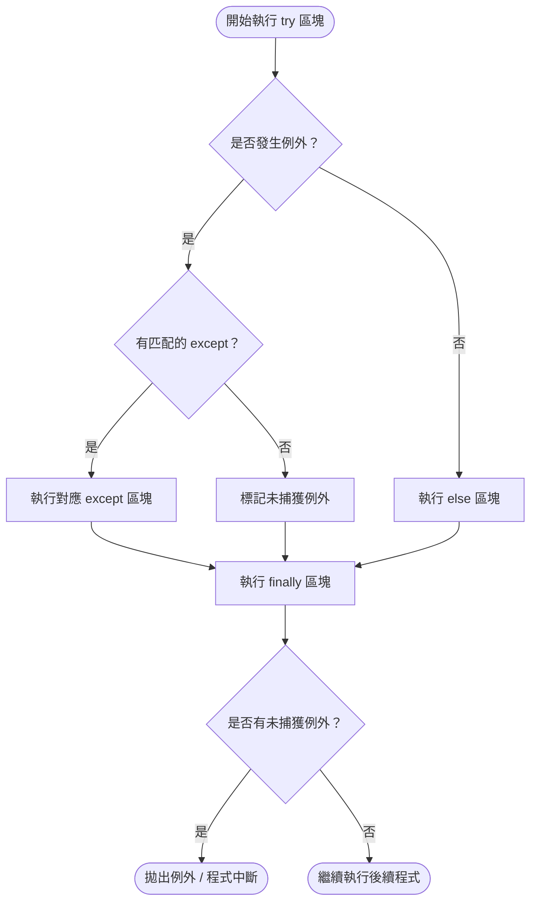

# Python 例外處理（Exception Handling）完全指南：從入門到精通的防禦性程式設計

歡迎來到 Python 例外處理的專題教學！在寫程式的過程中，就算語法完全正確，程式在執行時依然可能會遇到各種意料之外的狀況（例如：使用者輸入文字而非數字、檔案不存在、網路斷線、除以零等）。

> **「程式設計師的功力，不在於寫出不出錯的程式碼，而在於懂得如何優雅地面對錯誤。」**

本講義專門針對「例外處理」進行由淺至深的系統化解析，透過豐富的範例、生活比喻與實戰練習，帶領學生掌握讓程式永不崩潰的防禦性程式設計技巧！

---

## 目錄
1. [觀念導入：為什麼需要例外處理？](#1-觀念導入為什麼需要例外處理)
   - 1.1 [語法錯誤（Syntax Errors） vs. 執行時期例外（Exceptions）](#11-語法錯誤syntax-errors-vs-執行時期例外exceptions)
   - 1.2 [如果不處理例外會發生什麼？（程式崩潰 vs. 優雅復原）](#12-如果不處理例外會發生什麼程式崩潰-vs-優雅復原)
2. [基礎核心：try ... except 語法](#2-基礎核心try--except-語法)
   - 2.1 [最基本的結構](#21-最基本的結構)
   - 2.2 [指定特定例外類型（精準防禦）](#22-指定特定例外類型精準防禦)
   - 2.3 [同時攔截多個例外（Multiple Exceptions）](#23-同時攔截多個例外multiple-exceptions)
   - 2.4 [取得系統錯誤詳細訊息：as e](#24-取得系統錯誤詳細訊息as-e)
3. [完整四部曲：try - except - else - finally](#3-完整四部曲try---except---else---finally)
   - 3.1 [為什麼需要 else？（一切正常才執行）](#31-為什麼需要-else一切正常才執行)
   - 3.2 [為什麼需要 finally？（無論如何都要執行的善後保證）](#32-為什麼需要-finally無論如何都要執行的善後保證)
   - 3.3 [四部曲執行流程圖](#33-四部曲執行流程圖)
4. [主動出擊：使用 raise 引發例外](#4-主動出擊使用-raise-引發例外)
   - 4.1 [為什麼要自己引發例外？](#41-為什麼要自己引發例外)
   - 4.2 [raise 的基本語法與實務檢查](#42-raise-的基本語法與實務檢查)
   - 4.3 [重新引發例外（Re-raise）](#43-重新引發例外re-raise)
5. [進階主題：自訂例外類別（Custom Exceptions）](#5-進階主題自訂例外類別custom-exceptions)
   - 5.1 [為什麼要自訂例外？](#51-為什麼要自訂例外)
   - 5.2 [繼承 Exception 基礎類別](#52-繼承-exception-基礎類別)
   - 5.3 [在自訂例外中封裝詳細資訊](#53-在自訂例外中封裝詳細資訊)
6. [常見例外速查與設計哲學](#6-常見例外速查與設計哲學)
   - 6.1 [Python 常見內建例外清單](#61-python-常見內建例外清單)
   - 6.2 [例外繼承樹與攔截地雷（避免裸露 except:）](#62-例外繼承樹與攔截地雷避免裸露-except)
   - 6.3 [Python 哲學：EAFP vs. LBYL](#63-python-哲學eafp-vs-lbyl)
7. [實戰演練：安全銀行帳戶轉帳系統](#7-實戰演練安全銀行帳戶轉帳系統)
8. [隨堂動手練習與解答](#8-隨堂動手練習與解答)

---

## 1. 觀念導入：為什麼需要例外處理？

### 1.1 語法錯誤（Syntax Errors） vs. 執行時期例外（Exceptions）

在 Python 中，「錯誤（Error）」主要可以分為兩大類：

| 類型 | 英文名 | 發生時機 | 原因 | 程式是否能執行？ | 舉例 |
| :--- | :--- | :--- | :--- | :--- | :--- |
| **語法錯誤** | Syntax Error | **編譯/解析階段** | 寫法不符合 Python 文法規則（少括號、冒號等） | **完全無法啟動** | `if x == 5` 後面少加 `:` |
| **執行時期例外** | Exception | **程式執行中** | 語法正確，但在執行到某一行時遇到無法處理的邏輯或外部狀況 | **啟動後執行到該行中斷** | `10 / 0`、找不到檔案、型別轉型失敗 |

```python
# 這是【語法錯誤】（SyntaxError）：執行前 Python 就會報錯阻止執行
# if True
#     print("Hello")

# 這是【執行時期例外】（ZeroDivisionError）：語法合規，但執行到此處會引爆崩潰
print("程式開始")
result = 10 / 0  # 💥 ZeroDivisionError: division by zero
print("程式結束")  # 這一行永遠不會被執行到！
```

### 1.2 如果不處理例外會發生什麼？（程式崩潰 vs. 優雅復原）

- **沒有例外處理**：一旦發生例外，Python 直譯器會印出長長的一串錯誤追蹤（Traceback），並且**立即強制中止整個程式**。如果這是一個正在運行的網站伺服器或自動化交易機器人，直接中斷會造成嚴重災難！
- **有例外處理**：如同為程式系上安全帶。當意外發生時，我們可以「攔截（catch）」這個錯誤，執行替代方案（例如：印出親切的提示字串、記錄日誌、自動重試），讓程式能**優雅地繼續運作**。

> [!TIP]
> **生活比喻：安全氣囊**  
> 汽車不是為了撞車而設計的，但每一輛車都必須配備安全氣囊。例外處理就是程式的安全氣囊，當撞擊（錯誤）發生時能保護系統不至於粉身碎骨。

---

## 2. 基礎核心：try ... except 語法

### 2.1 最基本的結構

例外處理最核心的關鍵字是 `try` 與 `except`：
- **`try` 區塊**：放入「可能會引發錯誤」的危險程式碼。
- **`except` 區塊**：放「如果出錯了，該怎麼處理」的救援程式碼。

```python
try:
    number = int(input("請輸入一個整數: "))
    print(f"您輸入的數字是：{number}")
except:
    print("輸入錯誤！請確認您輸入的是不是整數。")

print("程式順利執行完畢，繼續下一段工作。")
```

**執行流程解說：**
1. 若使用者輸入 `42`：`try` 區塊正常執行，跳過 `except` 區塊，印出「程式順利執行完畢」。
2. 若使用者輸入 `abc`：在 `int("abc")` 處引發 `ValueError`，Python 立即中斷 `try` 區塊，跳轉進 `except` 區塊執行提示，程式**不會**崩潰退出！

---

### 2.2 指定特定例外類型（精準防禦）

前一個範例中的 `except:` 攔截了所有可能的問題，這在實務上並不是好習慣（如同感冒藥不能包醫百病）。我們應該**精確指出**想處理的例外名稱。

```python
try:
    num1 = int(input("請輸入被除數: "))
    num2 = int(input("請輸入除數: "))
    result = num1 / num2
    print(f"計算結果: {num1} / {num2} = {result}")

except ZeroDivisionError:
    # 專門抓「除以零」的錯誤
    print("【錯誤】除數不能為 0！")

except ValueError:
    # 專門抓「資料型別轉換失敗」的錯誤
    print("【錯誤】請輸入有效的阿拉伯數字！")
```

**測試情境：**
- 輸入 `10` 與 `2` $\rightarrow$ 輸出 `計算結果: 10 / 2 = 5.0`
- 輸入 `10` 與 `0` $\rightarrow$ 觸發 `ZeroDivisionError`，輸出 `【錯誤】除數不能為 0！`
- 輸入 `十` 與 `2` $\rightarrow$ 觸發 `ValueError`，輸出 `【錯誤】請輸入有效的阿拉伯數字！`

---

### 2.3 同時攔截多個例外（Multiple Exceptions）

如果多個例外想要使用**相同的處理邏輯**，可以將它們用括號包成 `tuple`（元組）：

```python
try:
    data = [10, 20, 30]
    idx = int(input("請輸入要查詢的索引 (0~2): "))
    print(f"位置 {idx} 的元素是: {data[idx]}")

except (ValueError, IndexError):
    # 無論是輸入非數字（ValueError），還是輸入超出範圍（IndexError），都走這條路
    print("輸入無效！請確保輸入的是範圍內的整數索引 (0, 1, 2)。")
```

---

### 2.4 取得系統錯誤詳細訊息：as e

有時候我們想知道 Python 原生提供的錯誤細節，可以用 `as 變數名`（通常簡寫為 `e` 或 `err`）將例外物件存下來：

```python
try:
    with open("not_exist_file.txt", "r", encoding="utf-8") as f:
        content = f.read()

except FileNotFoundError as e:
    print(f"捕獲檔案找不到例外！")
    print(f"系統錯誤訊息: {e}")
    print(f"出錯的檔案路徑: {e.filename}")
```

**輸出結果：**
```text
捕獲檔案找不到例外！
系統錯誤訊息: [Errno 2] No such file or directory: 'not_exist_file.txt'
出錯的檔案路徑: not_exist_file.txt
```

---

## 3. 完整四部曲：try - except - else - finally

Python 提供了極為完善的例外處理語法架構，完整的結構包含四個關鍵字：

```python
try:
    # 1. 嘗試執行的程式碼（可能有危險）
    pass
except 某錯誤類型:
    # 2. 如果 try 發生指定錯誤，執行這裡
    pass
else:
    # 3. 如果 try 完全沒有發生錯誤，執行這裡
    pass
finally:
    # 4. 無論有沒有發生錯誤，最後一定會執行這裡（善後作業）
    pass
```

### 3.1 為什麼需要 else？（一切正常才執行）

很多人會問：「既然 `try` 沒出錯會繼續往下跑，為什麼還要 `else`？」

> [!NOTE]
> **好處：縮小 try 區塊的守備範圍**  
> `try` 區塊應該只放「真正有風險的一兩行程式」。如果把後續不具風險的商業邏輯也放進 `try` 裡面，萬一後面的程式也噴出同名例外，就會造成混淆除錯困難。

```python
try:
    num = int(input("請輸入一個正整數: "))
except ValueError:
    print("輸入格式不正確！")
else:
    # 只有在 int() 成功時才會進到這裡
    if num % 2 == 0:
        print(f"{num} 是偶數。")
    else:
        print(f"{num} 是奇數。")
```

---

### 3.2 為什麼需要 finally？（無論如何都要執行的善後保證）

`finally` 區塊最大的特色是：**無論 `try` 是正常結束、中途出錯被 `except` 攔截，甚至是遇到 `return` 或沒有被攔截的嚴重錯誤，`finally` 保證一定會被執行！**

常見用途：
- 關閉已打開的檔案
- 斷開資料庫連線或網路連線
- 釋放鎖（Lock）或清理暫存檔

```python
file = None
try:
    print("1. 嘗試開啟檔案...")
    file = open("sample.txt", "w", encoding="utf-8")
    file.write("寫入測試資料")
    # 模擬中間突然發生計算錯誤
    x = 1 / 0 

except ZeroDivisionError:
    print("2. 攔截到計算錯誤！")

finally:
    print("3. 執行 finally 區塊：關閉檔案資源")
    if file and not file.closed:
        file.close()
        print("   檔案已安全關閉。")

print("4. 程式繼續正常執行。")
```

---

### 3.3 四部曲執行流程圖



---

## 4. 主動出擊：使用 raise 引發例外

到目前為止，我們都是被動地等待 Python 直譯器拋出例外。但在許多時候，程式語法上完全合法，但在「業務邏輯（Business Logic）」上是錯的！這時候我們就要主動使用 `raise` 來發出警告。

### 4.1 為什麼要自己引發例外？

例如：
- 提款金額為負數（`withdraw(-100)`）$\rightarrow$ Python 語法不會報錯，但邏輯完全錯誤！
- 使用者年齡填寫 `250` 歲 $\rightarrow$ 數字有效，但超乎常理！

如果不主動擋下來，錯誤的資料會繼續在系統中流竄，造成後續更難以追查的詭異 bug。

---

### 4.2 raise 的基本語法與實務檢查

使用方式：`raise 例外類別名稱("自訂錯誤訊息")`

```python
def set_age(age: int):
    if not isinstance(age, int):
        raise TypeError(f"年齡必須為整數，您傳入的是 {type(age).__name__}")
    
    if age < 0 or age > 130:
        raise ValueError(f"年齡超出合理範圍 (0~130): 收到 {age}")
    
    print(f"年齡設定成功：{age} 歲")

# 測試調用
try:
    set_age(25)     # 正常
    set_age(-5)     # 將觸發 ValueError
except (TypeError, ValueError) as err:
    print(f"驗證失敗: {err}")
```

---

### 4.3 重新引發例外（Re-raise）

有時候在底層函式捕獲了錯誤並做了日誌紀錄（Log），但希望將這個錯誤**繼續往上丟**給呼叫者知道，可以直接寫單獨一個 `raise`：

```python
def process_payment(amount):
    try:
        # 模擬呼叫第三方支付 API
        if amount <= 0:
            raise ValueError("交易金額不得小於或等於 0")
        print(f"正在扣款 NT$ {amount}...")
    except ValueError as e:
        print(f"[Log 紀錄] 交易失敗記錄: {e}")
        raise  # 重新拋出當前的例外，交給外層主程式決定如何顯示給使用者
```

---

## 5. 進階主題：自訂例外類別（Custom Exceptions）

在大型專案中，Python 內建的 `ValueError`、`TypeError` 往往過於籠統。建立具有專屬語意的「自訂例外類別」，能讓程式結構更加清晰、模組化。

### 5.1 為什麼要自訂例外？
- 讓呼叫者能精準只攔截專屬你的模組所產生的錯誤。
- 程式碼自我解釋性（Self-documenting）更強。例如看到 `InsufficientBalanceError` 比看到通用的 `ValueError` 能一眼看懂問題。

---

### 5.2 繼承 Exception 基礎類別

自訂例外只需宣告一個繼承自 `Exception`（或其子類）的類別即可：

```python
# 1. 定義自訂例外類別
class NegativeDepositError(Exception):
    """當存款金額為負數或 0 時引發"""
    pass

class InsufficientBalanceError(Exception):
    """當帳戶餘額不足以提款時引發"""
    pass

# 2. 模擬銀行帳戶
class BankAccount:
    def __init__(self, owner: str, balance: float = 0.0):
        self.owner = owner
        self.balance = balance

    def deposit(self, amount: float):
        if amount <= 0:
            raise NegativeDepositError(f"存款金額必須大於 0，輸入金額: {amount}")
        self.balance += amount
        print(f"[{self.owner}] 成功存入 {amount} 元，目前餘額: {self.balance}")

    def withdraw(self, amount: float):
        if amount > self.balance:
            raise InsufficientBalanceError(
                f"餘額不足！欲提領: {amount}，目前帳戶餘額: {self.balance}"
            )
        self.balance -= amount
        print(f"[{self.owner}] 成功提領 {amount} 元，目前餘額: {self.balance}")

# 3. 測試使用自訂例外
account = BankAccount("小明", 1000)

try:
    account.deposit(500)
    account.withdraw(2000)  # 💥 超過餘額

except InsufficientBalanceError as err:
    print(f"【提款拒絕】{err}")
except NegativeDepositError as err:
    print(f"【存款拒絕】{err}")
```

---

### 5.3 在自訂例外中封裝詳細資訊

我們甚至可以覆寫 `__init__`，讓例外物件攜帶豐富的上下文資料（例如：帳號代碼、短缺金額等）：

```python
class TransferLimitExceededError(Exception):
    def __init__(self, limit: float, requested: float):
        self.limit = limit
        self.requested = requested
        self.diff = requested - limit
        message = f"單筆轉帳超額！上限為 {limit}，請求金額為 {requested}（超額 {self.diff}）"
        super().__init__(message)

try:
    max_limit = 50000
    transfer_amount = 68000
    if transfer_amount > max_limit:
        raise TransferLimitExceededError(max_limit, transfer_amount)
except TransferLimitExceededError as e:
    print(f"警告：{e}")
    print(f"請調低轉帳金額至少 {e.diff} 元後再試。")
```

---

## 6. 常見例外速查與設計哲學

### 6.1 Python 常見內建例外清單

| 例外名稱 | 觸發時機 | 範例程式碼 |
| :--- | :--- | :--- |
| `ZeroDivisionError` | 任何數除以 0 | `10 / 0` |
| `ValueError` | 引數型別正確，但給的值不合適 | `int("hello")` |
| `TypeError` | 引數型別不合適 | `"age: " + 18` |
| `IndexError` | List/Tuple 索引超出範圍 | `[1, 2][5]` |
| `KeyError` | Dictionary 查無此鍵 | `{"name": "Amy"}["age"]` |
| `FileNotFoundError` | 讀取不存在的檔案路徑 | `open("ghost.txt")` |
| `AttributeError` | 嘗試存取物件沒有的屬性或方法 | `"hello".push()` |
| `KeyboardInterrupt` | 使用者在終端機按下 `Ctrl + C` | 程式執行中按中斷鍵 |

---

### 6.2 例外繼承樹與攔截地雷（避免裸露 except:）

Python 的所有例外都是類別繼承階層：

```text
BaseException
 ├── SystemExit (系統退出指令)
 ├── KeyboardInterrupt (使用者按 Ctrl+C)
 └── Exception (所有標準程式例外的祖先)
      ├── ArithmeticError
      │    └── ZeroDivisionError
      ├── LookupError
      │    ├── IndexError
      │    └── KeyError
      ├── ValueError
      └── OSError
           └── FileNotFoundError
```

> [!CAUTION]
> **切勿犯的大忌：裸露的 `except:`**
> ```python
> # ❌ 極度糟糕的寫法：
> try:
>     run_server()
> except:
>     pass
> ```
> 這會捕獲包含 `KeyboardInterrupt` 與 `SystemExit` 在內的所有例外！使用者按 `Ctrl + C` 也無法關閉程式，甚至當程式碼出現拼字錯誤時也被悄悄吞掉，讓你永遠除不了錯！  
> **正確原則**：優先攔截明確的具體例外（如 `except ValueError:`）；最寬鬆也只能到 `except Exception:`。

---

### 6.3 Python 哲學：EAFP vs. LBYL

在寫條件判斷與例外處理時，程式設計界有兩種著名流派：

1. **LBYL (Look Before You Leap)**：「三思而後行」
   - 在做事之前先用大量的 `if-else` 做檢查。
2. **EAFP (Easier to Ask for Forgiveness than Permission)**：「先做再說，出錯再道歉」
   - **這是 Python 官方強烈推崇的核心風格！**
   - 直接執行 `try`，遇到例外再用 `except` 處理。通常程式碼更簡潔、少一次重複查找，且能避免並行時的競態條件（Race Conditions）。

```python
person = {"name": "小美"}

# 風格 A：LBYL（傳統檢查）
if "age" in person:
    print(person["age"])
else:
    print("未提供年齡")

# 風格 B：EAFP（Pythonic 推薦風格）
try:
    print(person["age"])
except KeyError:
    print("未提供年齡")
```

---

## 7. 實戰演練：安全銀行帳戶轉帳系統

讓我們將學到的 `try-except-else-finally`、`raise` 與自訂例外整合進一個完整的練習案例：

```python
# -----------------------------
# 定義領域專屬例外
# -----------------------------
class BankingError(Exception):
    """所有銀行業務例外的母類別"""
    pass

class InsufficientFundsError(BankingError):
    """餘額不足例外"""
    pass

class InvalidAmountError(BankingError):
    """無效金額例外（如小於等於 0）"""
    pass


# -----------------------------
# 轉帳交易核心邏輯
# -----------------------------
def transfer(sender: str, receiver: str, amount: float, accounts: dict):
    """
    執行轉帳交易
    :param sender: 轉出帳號
    :param receiver: 轉入帳號
    :param amount: 轉帳金額
    :param accounts: 帳戶資料字典 {帳號: 餘額}
    """
    print(f"\n[開始交易] 準備從 {sender} 轉帳 {amount} 元至 {receiver}")
    
    try:
        # 1. 驗證金額
        if amount <= 0:
            raise InvalidAmountError(f"轉帳金額必須大於 0，收到: {amount}")

        # 2. 驗證帳號是否存在
        if sender not in accounts:
            raise KeyError(f"轉出帳號不存在: '{sender}'")
        if receiver not in accounts:
            raise KeyError(f"轉入帳號不存在: '{receiver}'")

        # 3. 驗證餘額是否充足
        if accounts[sender] < amount:
            raise InsufficientFundsError(
                f"帳號 {sender} 餘額不足 (目前: {accounts[sender]}, 需: {amount})"
            )

        # 4. 執行扣款與入帳
        accounts[sender] -= amount
        accounts[receiver] += amount

    except BankingError as b_err:
        print(f"❌ 業務規則錯誤: {b_err}")
    except KeyError as k_err:
        print(f"❌ 查無帳戶資料: {k_err}")
    except Exception as unexpected:
        print(f"❌ 發生未預期的系統錯誤: {unexpected}")
    else:
        print(f"✅ 轉帳成功！")
        print(f"   {sender} 剩餘金額: {accounts[sender]}")
        print(f"   {receiver} 目前金額: {accounts[receiver]}")
    finally:
        print("[交易結束] 已留下系統安全稽核日誌 (Audit Log)。")


# -----------------------------
# 系統測試
# -----------------------------
bank_db = {
    "user_A": 5000,
    "user_B": 1200
}

# 測試 1：正常轉帳
transfer("user_A", "user_B", 2000, bank_db)

# 測試 2：餘額不足
transfer("user_A", "user_B", 10000, bank_db)

# 測試 3：負數金額
transfer("user_A", "user_B", -500, bank_db)

# 測試 4：不存在的帳號
transfer("user_A", "user_Ghost", 500, bank_db)
```

---

## 8. 隨堂動手練習與解答

### 練習 1：安全的整數輸入函式
請實作一個函式 `safe_input_int(prompt, min_val=None, max_val=None)`：
- 提示使用者輸入數字。
- 若使用者輸入非整數，印出錯誤訊息並**持續循環要求重新輸入**，直到輸入合法整數為止。
- 若指定了 `min_val` 或 `max_val`，且輸入不在範圍內，需引發或提示超出範圍並重新輸入。

```python
# 題目 1 參考解答
def safe_input_int(prompt="請輸入整數: ", min_val=None, max_val=None):
    while True:
        try:
            val = int(input(prompt))
            if min_val is not None and val < min_val:
                print(f"數值不能小於 {min_val}，請重新輸入！")
                continue
            if max_val is not None and val > max_val:
                print(f"數值不能大於 {max_val}，請重新輸入！")
                continue
            return val
        except ValueError:
            print("格式錯誤！請輸入有效的整數。")

# 測試
# age = safe_input_int("請輸入您的年齡 (1~120): ", min_val=1, max_val=120)
# print(f"設定成功！您的年齡是: {age}")
```

---

### 練習 2：檔案讀取與統計器
請撰寫一個函式 `count_words_in_file(filepath)`：
- 嘗試開啟指定路徑的文字檔，統計裡面的總字數（依空白分隔）。
- 必須完整使用 `try ... except ... else ... finally` 四部曲：
  - 捕捉 `FileNotFoundError`，印出「找不到該檔案」。
  - 沒出錯（`else`）時印出字數統計。
  - `finally` 確保印出「讀檔工作程序結束」。

```python
# 題目 2 參考解答
def count_words_in_file(filepath):
    f = None
    try:
        f = open(filepath, "r", encoding="utf-8")
        content = f.read()
    except FileNotFoundError:
        print(f"【錯誤】找不到檔案: '{filepath}'")
    except UnicodeDecodeError:
        print(f"【錯誤】檔案編碼錯誤，無法解碼為 UTF-8。")
    else:
        words = content.split()
        print(f"檔案 '{filepath}' 讀取成功！總計單詞數: {len(words)}")
    finally:
        if f and not f.closed:
            f.close()
        print("讀檔工作程序結束。")

# 測試
# count_words_in_file("example.txt")
```

---

### 練習 3：帳號密碼註冊驗證（搭配自訂例外）
設計一個使用者註冊函式 `register_user(username, password)`：
1. 定義兩個自訂例外：`UsernameInvalidError`、`PasswordTooShortError`。
2. 驗證規則：
   - 使用者名稱（username）長度至少 3 個字元，且不能包含空格；否則引發 `UsernameInvalidError`。
   - 密碼（password）長度至少 8 個字元；否則引發 `PasswordTooShortError`。
3. 撰寫呼叫端程式碼，針對不同例外給予適當提示。

```python
# 題目 3 參考解答
class RegistrationError(Exception):
    """註冊基礎例外"""
    pass

class UsernameInvalidError(RegistrationError):
    pass

class PasswordTooShortError(RegistrationError):
    pass

def register_user(username, password):
    if len(username) < 3 or " " in username:
        raise UsernameInvalidError("使用者名稱至少需 3 個字元且不能包含空白！")
    if len(password) < 8:
        raise PasswordTooShortError(f"密碼長度不足 8 碼（目前僅 {len(password)} 碼）！")
    
    print(f"🎉 恭喜！使用者 '{username}' 註冊成功！")
    return True

# 測試
test_accounts = [
    ("ab", "12345678"),         # 帳號太短
    ("user A", "12345678"),     # 帳號有空格
    ("alice", "12345"),         # 密碼太短
    ("charlie", "secret1234")   # 成功
]

for u, p in test_accounts:
    try:
        print(f"\n嘗試註冊帳號: {u}")
        register_user(u, p)
    except UsernameInvalidError as err:
        print(f"帳號不合規: {err}")
    except PasswordTooShortError as err:
        print(f"密碼不合規: {err}")
```
